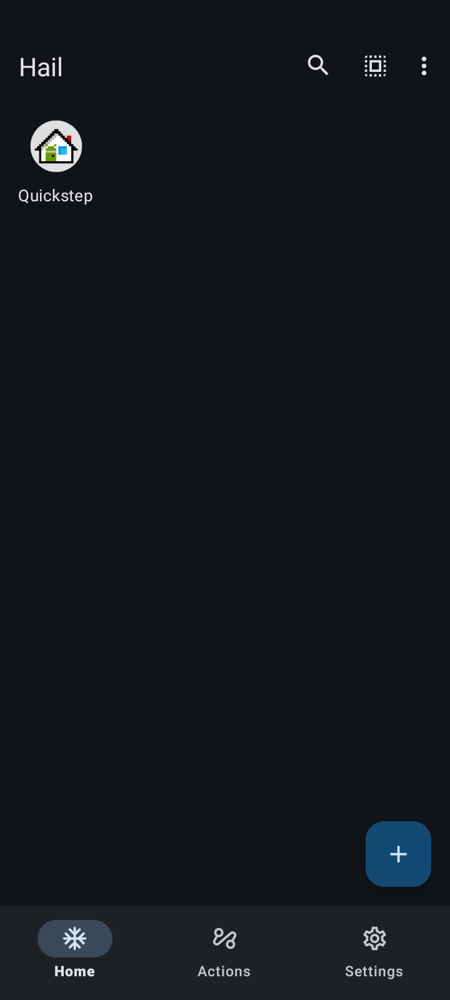
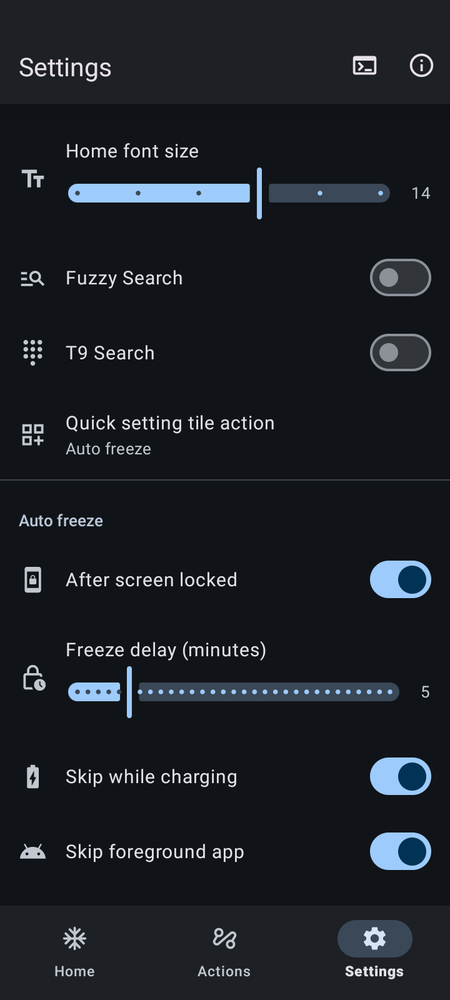

## Preview

## Download

*Requires Android 7.0 or higher.*

## Features

* Automatically Disable, Hide, Stop or Suspend apps
* Support Root, Shizuku, Dhizuku and more
* Create Actions to open multiple apps at the same time
* Backup/Restore lists, settings and preferences
* Incredibly fast
* And much more...

## Credits

Thank you to all the people who have contributed!

### License

<pre>

Copyright (C) 2026 Rahatul Ghazi
Copyright (C) 2021-2026 Aistra
Copyright (C) 2022-2026 Hail contributors

This program is free software: you can redistribute it and/or modify it under the terms of the GNU General Public License as published by the Free Software Foundation, either version 3 of the License, or any later version.

This program is distributed in the hope that it will be useful, but WITHOUT ANY WARRANTY; without even the implied warranty of MERCHANTABILITY or FITNESS FOR A PARTICULAR PURPOSE. See the <a href=https://www.gnu.org/licenses/gpl-3.0.html>GNU General Public License</a> for more details.

You should have received a copy of the GNU General Public License along with this program. If not, see the <a href=https://www.gnu.org/licenses>GNU Licenses</a>.

</pre>

